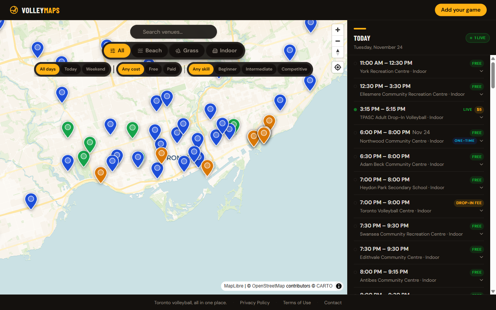

# VolleyMaps

VolleyMaps helps people find pickup volleyball games around Toronto. Browse games on a map, check venue schedules, and RSVP.

[Open the live site](https://volleymaps.vercel.app)



## Built with

- Next.js and TypeScript
- Neon Postgres
- MapLibre GL JS with CartoDB Voyager map tiles
- Tailwind CSS and shadcn/ui
- Vercel

## Data

Organizers can submit games and venues through the site. Approved listings appear on the map. City of Toronto adult drop-in volleyball schedules are synced from the city's open data catalogue.

## Run locally

With Node.js 24 installed:

```bash
npm ci
npm run dev
```

Open [http://localhost:3000](http://localhost:3000). Without `DATABASE_URL`, the site uses built-in mock data. No secrets are needed to explore it locally.

## Built by

[Nimo Benne](https://nimobenne.github.io)
